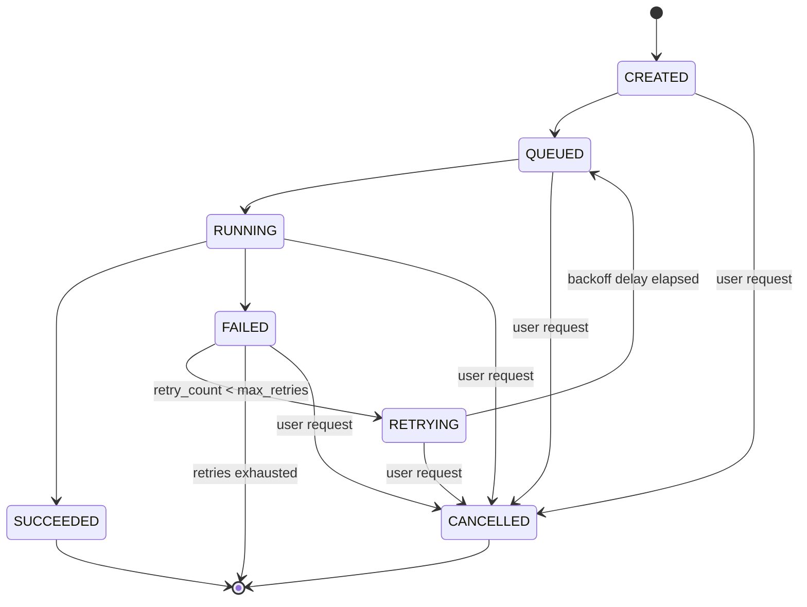

# TaskFlow: Distributed Job Scheduler & Workflow Engine

TaskFlow is a lightweight, distributed job scheduler and asynchronous workflow execution engine built with **Python 3.11+**, **FastAPI**, **Pydantic**, **AWS DynamoDB**, and **AWS S3**.

Designed with clean architecture and production design patterns, TaskFlow decouples state management, storage backends, and execution workers. It runs seamlessly **locally in-memory** with zero cloud dependencies or **in production with AWS services**.

---

## Architecture Overview

```
                      +------------------------------------+
                      |         HTTP REST Clients          |
                      +-----------------+------------------+
                                        |
                                        v
                            +-----------------------+
                            |     FastAPI App       |
                            |    (/jobs, /logs)     |
                            +-----------+-----------+
                                        |
                 +----------------------+----------------------+
                 |                                             |
                 v                                             v
     +-----------------------+                     +-----------------------+
     |   Job State Machine   |                     |     Job Scheduler     |
     |  (Strict Transitions) |                     |  (Cron / Recurring)   |
     +-----------+-----------+                     +-----------+-----------+
                 |                                             |
                 +----------------------+----------------------+
                                        |
                 +----------------------+----------------------+
                 |                                             |
                 v                                             v
     +-----------------------+                     +-----------------------+
     |   Job Repository      |                     |      Log Store        |
     |   (Abstract ABC)      |                     |    (Abstract ABC)     |
     +-----------+-----------+                     +-----------+-----------+
                 |                                             |
        +--------+--------+                           +--------+--------+
        |                 |                           |                 |
        v                 v                           v                 v
+---------------+ +---------------+           +---------------+ +---------------+
|   InMemory    | |   DynamoDB    |           |   InMemory    | |    AWS S3     |
|  Repository   | |  (Atomic CAS) |           |   Log Store   | |  Log Bucket   |
+---------------+ +---------------+           +---------------+ +---------------+
                                        ^
                                        |
                            +-----------+-----------+
                            |      Worker Pool      |
                            | (ThreadPoolExecutor + |
                            |  Exponential Backoff) |
                            +-----------------------+
```

### Key Design Highlights (Interview Talking Points)
1. **Explicit State Machine (`state_machine.py`)**: Transitions strictly follow formal rules (`CREATED -> QUEUED -> RUNNING -> SUCCEEDED / FAILED -> RETRYING -> QUEUED`, or cancellation from any non-final state). Invalid transitions immediately fail with detailed errors.
2. **Repository & Storage Abstraction (`repository.py`, `log_store.py`)**: Decouples business logic from persistence. Switch between 100% in-memory storage (for quick local development and sub-second tests) and AWS cloud infrastructure via an environment flag (`USE_AWS=true`).
3. **Optimistic Concurrency Control / Atomic Job Acquisition**: Prevents race conditions where two workers could pick up the same job.
   - *In-Memory*: Mutex-protected check-and-set.
   - *DynamoDB*: Atomic conditional update (`ConditionExpression="state = :queued"`). If two workers attempt to acquire the job simultaneously, DynamoDB raises `ConditionalCheckFailedException`, guaranteeing exactly-once acquisition.
4. **Resilient Retry with Exponential Backoff**: Failed jobs automatically retry up to 3 times with exponential backoff delays ($1\text{s}, 2\text{s}, 4\text{s}$) before entering the terminal `FAILED` state.
5. **Recurring Jobs (`scheduler.py`)**: Supports standard 5-part cron syntax (e.g. `*/5 * * * *`) powered by `croniter` to automatically re-queue recurring tasks on schedule.

---

## State Transition Rules



---

## Getting Started Locally

### 1. Prerequisites
- Python 3.11+
- Git

### 2. Installation
```bash
# Clone the repository
git clone https://github.com/your-username/taskflow.git
cd taskflow

# Create and activate virtual environment
python -m venv .venv
# Windows:
.venv\Scripts\activate
# Linux/macOS:
source .venv/bin/activate

# Install dependencies
pip install -r requirements.txt
```

### 3. Running Locally (In-Memory Mode, No AWS Needed)
By default, `USE_AWS=false`, so TaskFlow runs purely in-memory:
```bash
uvicorn app.main:app --reload --port 8000
```
Open your browser to:
- Interactive API Docs (Swagger UI): **`http://localhost:8000/docs`**
- Alternative Docs (ReDoc): **`http://localhost:8000/redoc`**
- Health Check: **`http://localhost:8000/health`**

---

## API Usage Examples

### 1. Create a Job (`POST /jobs`)
```bash
curl -X POST "http://localhost:8000/jobs" \
  -H "Content-Type: application/json" \
  -d '{
    "name": "data-sync-task",
    "job_type": "echo",
    "payload": {"message": "Syncing analytics data to warehouse"},
    "max_retries": 3
  }'
```
Response:
```json
{
  "id": "e6745199-3549-436f-b1e8-782a9db4aa25",
  "name": "data-sync-task",
  "job_type": "echo",
  "payload": {
    "message": "Syncing analytics data to warehouse"
  },
  "state": "QUEUED",
  "retry_count": 0,
  "max_retries": 3,
  "error_message": null,
  "cron_expression": null,
  "created_at": "2026-10-16T06:30:00.000000+00:00",
  "updated_at": "2026-10-16T06:30:00.000000+00:00"
}
```

### 2. Inspect Job Details (`GET /jobs/{id}`)
```bash
curl "http://localhost:8000/jobs/e6745199-3549-436f-b1e8-782a9db4aa25"
```

### 3. List Jobs with State Filter (`GET /jobs?state=SUCCEEDED`)
```bash
curl "http://localhost:8000/jobs?state=SUCCEEDED"
```

### 4. Fetch Execution Logs (`GET /jobs/{id}/logs`)
```bash
curl "http://localhost:8000/jobs/e6745199-3549-436f-b1e8-782a9db4aa25/logs"
```
Response:
```json
{
  "job_id": "e6745199-3549-436f-b1e8-782a9db4aa25",
  "logs": "[CREATED] Job 'data-sync-task' queued successfully.\n[START] Starting execution of job 'data-sync-task' (type=echo, attempt=1/4)\n[INFO] Echoing payload message: Syncing analytics data to warehouse\n[SUCCESS] Execution completed: Echo successful: Syncing analytics data to warehouse\n"
}
```

### 5. Cancel an In-Flight Job (`POST /jobs/{id}/cancel`)
```bash
curl -X POST "http://localhost:8000/jobs/e6745199-3549-436f-b1e8-782a9db4aa25/cancel"
```

### 6. Create a Recurring Cron Job
```bash
curl -X POST "http://localhost:8000/jobs" \
  -H "Content-Type: application/json" \
  -d '{
    "name": "hourly-cleanup",
    "job_type": "echo",
    "payload": {"message": "Cleaned temp files"},
    "cron_expression": "0 * * * *"
  }'
```

---

## Running with Real AWS Services

To run TaskFlow connected to live AWS DynamoDB and S3:

1. **Set Environment Variables**:
   ```bash
   export USE_AWS=true
   export AWS_REGION=us-east-1
   export DYNAMODB_TABLE_NAME=taskflow-jobs
   export S3_BUCKET_NAME=taskflow-logs
   export AWS_ACCESS_KEY_ID=your_access_key
   export AWS_SECRET_ACCESS_KEY=your_secret_key
   ```
2. **Provision AWS Resources**:
   - **DynamoDB Table**: `taskflow-jobs`
     - Partition key: `job_id` (String)
     - Global Secondary Index (GSI): Name `state-index`, Partition key `state` (String)
   - **S3 Bucket**: `taskflow-logs`
3. **Start the Engine**:
   ```bash
   uvicorn app.main:app --host 0.0.0.0 --port 8000
   ```

---

## Running Automated Tests & Coverage

TaskFlow features a comprehensive test suite covering unit transitions, concurrency, backoff mathematics, API endpoints, and AWS integration mocked via `moto`.

```bash
# Run all tests
pytest -v

# Run tests with detailed coverage report
pytest --cov=app --cov-report=term-missing
```

### Sample Coverage Output
```
Name                   Stmts   Miss  Cover   Missing
----------------------------------------------------
app\__init__.py            0      0   100%
app\config.py             16      0   100%
app\log_store.py          56      6    89%
app\main.py               82      0   100%
app\models.py             69      0   100%
app\repository.py        102      8    92%
app\scheduler.py          99      6    94%
app\state_machine.py      25      0   100%
app\worker.py            141     12    91%
----------------------------------------------------
TOTAL                    590     32    95%
```

---

## Step-by-Step EC2 Deployment Guide (Amazon Linux 2023)

### 1. Launch EC2 Instance & Attach IAM Role
Launch an EC2 instance with **Amazon Linux 2023** (e.g. `t3.micro` or `t3.small`).

#### Required IAM Policy
Attach an IAM Role to your EC2 instance with the following least-privilege policy:
```json
{
  "Version": "2012-10-17",
  "Statement": [
    {
      "Sid": "DynamoDBAccess",
      "Effect": "Allow",
      "Action": [
        "dynamodb:PutItem",
        "dynamodb:GetItem",
        "dynamodb:UpdateItem",
        "dynamodb:Scan",
        "dynamodb:Query"
      ],
      "Resource": [
        "arn:aws:dynamodb:*:*:table/taskflow-jobs",
        "arn:aws:dynamodb:*:*:table/taskflow-jobs/index/*"
      ]
    },
    {
      "Sid": "S3LogsAccess",
      "Effect": "Allow",
      "Action": [
        "s3:PutObject",
        "s3:GetObject"
      ],
      "Resource": "arn:aws:s3:::taskflow-logs/*"
    }
  ]
}
```

### 2. Connect to the EC2 Instance & Install Dependencies
```bash
ssh -i your-key.pem ec2-user@<ec2-public-ip>

# Update packages and install Python 3.11 + git
sudo dnf update -y
sudo dnf install -y python3.11 python3.11-pip git

# Clone repository
git clone https://github.com/your-username/taskflow.git /home/ec2-user/taskflow
cd /home/ec2-user/taskflow

# Setup virtual environment
python3.11 -m venv venv
source venv/bin/activate
pip install --upgrade pip
pip install -r requirements.txt
```

### 3. Create System Environment File
Create `/home/ec2-user/taskflow/.env`:
```ini
USE_AWS=true
AWS_REGION=us-east-1
DYNAMODB_TABLE_NAME=taskflow-jobs
S3_BUCKET_NAME=taskflow-logs
MAX_WORKERS=4
POLL_INTERVAL_SECONDS=0.5
```

### 4. Configure `systemd` Service
Create systemd unit file at `/etc/systemd/system/taskflow.service`:
```ini
[Unit]
Description=TaskFlow Workflow Engine & API Service
After=network.target

[Service]
Type=simple
User=ec2-user
WorkingDirectory=/home/ec2-user/taskflow
EnvironmentFile=/home/ec2-user/taskflow/.env
ExecStart=/home/ec2-user/taskflow/venv/bin/uvicorn app.main:app --host 0.0.0.0 --port 8000
Restart=always
RestartSec=5

[Install]
WantedBy=multi-user.target
```

### 5. Enable and Start TaskFlow
```bash
sudo systemctl daemon-reload
sudo systemctl enable taskflow
sudo systemctl start taskflow

# Verify service is running
sudo systemctl status taskflow

# View live service logs
journalctl -u taskflow -f
```

### 6. Verify Deployment
Ensure port `8000` is open in your EC2 Security Group inbound rules, then test via curl:
```bash
curl http://<ec2-public-ip>:8000/health
```
You will receive:
```json
{"status": "ok", "app": "TaskFlow"}
```

---

## License
MIT License. Built for technical interviews and production-ready portfolio demonstration.
